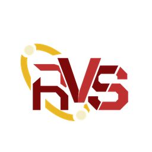

# 🛰️ RVDesk by RithV Services - Portable Remote Desktop

<p align="center">
  
  <br>
  <b>Fast, Secure, and 100% Free Remote Desktop Software</b>
  <br>
  <i>RVDesk by RithV Services • Single Portable .exe • Zero Server Cost • Self-Signed Authenticode • Encrypted P2P</i>
</p>

---

## 📥 Download & Install

All official builds are published at:

**https://github.com/dnlhrth01/rvsdesk/releases/latest**

| Asset | Description |
|---|---|
| `RVDesk-Downloader.bat` | 🚀 **Official Installer (Recommended)**: 1-Click Silent Smart Downloader & Launcher (Bypasses SmartScreen without prompts). |
| `RVDesk-Setup-<version>.exe` | Inno Setup installer (signed when the signing secrets are configured). |
| `RVDesk-Portable.exe` | Single-file portable build - no installation required. |
| `RVDesk-Portable.zip` | Portable bundle: `RVDesk.exe`, `Setup_Trust_RVDesk.bat`, `RVDesk-Launcher.bat`, `RVDesk-Downloader.bat`, and `RVDesk_Authority.cer`. |
| `Setup_Trust_RVDesk.bat` | One-click helper that trusts `RVDesk_Authority.cer` and clears the Mark of the Web. |
| `RVDesk-Launcher.bat` | SmartScreen-friendly launcher for the bundled `RVDesk.exe`. |
| `RVDesk_Authority.cer` | Public self-signed code-signing certificate for the portable line. |

> **Official Installer (Anti-SmartScreen Quick Start)**:
> Download `RVDesk-Downloader.bat` directly from the release page and run it. It fetches the official binary directly via GitHub API, clears the Mark-of-the-Web (Zone.Identifier) stream, registers certificate trust silently, and launches RVDesk immediately without Windows SmartScreen blocks.
>
> 💬 **Bantuan & Support**: Jika anda mengalami sebarang isu pemasangan atau sambungan, hubungi pasukan rasmi di **`rithvservices@gmail.com`**.

> The portable line is built from the stock RustDesk source, rebranded by `scripts/apply_branding.py`, then stamped with `rcedit` and verified (`ProductName` must read `RVDesk`). AGPL-3.0 attribution is retained in the binary metadata.

---

## ✨ Key Features of RVDesk

1. **Single Portable Binary (.exe)**:
   - No installation required.
   - Host and client users simply double-click to launch.
2. **Zero Cost & Private Infrastructure**:
   - Operates using **P2P (Peer-to-Peer Encrypted NAT Traversal)** protocol and your self-hosted relay (`console.danialharith.space`).
   - Screen data and control streams travel directly between endpoints without expensive third-party subscriptions.
3. **End-to-End Encryption**:
   - High security powered by modern cryptography (ChaCha20-Poly1305 and X25519 key exchange).
4. **Full Remote Desktop Feature Set**:
   - High-resolution screen streaming (up to 60 FPS).
   - Bi-directional file transfer.
   - Remote audio transmission and clipboard synchronization.
   - Portable elevation support to interact with Windows UAC / Administrator prompts.
5. **Zero-Cost Code Signing**:
   - Equipped with self-signed Authenticode automation and Microsoft Security Intelligence whitelisting guidance.
6. **Custom Brand Aesthetic (Crimson Red `#DC2626`)**:
   - Modern cybersecurity aesthetic with custom crimson red buttons, highlights, and status indicators.

---

## 🚀 Building & Distributing RVDesk

### Method 1: Automated Cloud Build via GitHub Actions (Official Release)
This is the **recommended approach** to build a clean portable binary with custom branding, stripped UAC cards, and controller authorization gates:

1. **Push Changes to GitHub**:
   ```bash
   git add .
   git commit -m "feat: update branding and security configuration"
   git push origin main
   ```
2. **Automated CI/CD Workflow**:
   - Go to the **Actions** tab in your GitHub repository.
   - The workflow `Build RVDesk Portable (Zero-Cost CI/CD)` runs automatically.
   - GitHub Actions will:
     - Inject RVDesk visual assets (`rvsdesk.ico` & high-res PNG logos).
     - Customize window titles and internal application identifiers to **RVDesk**.
     - Strip UAC banners and "Install" buttons from the UI.
     - Inject controller authorization security gates.
     - Package into a single executable (`RVDesk-Portable.exe`).
     - Stamp `ProductName=RVDesk` with `rcedit` and fail the build if the stamp does not verify.
     - Digitally sign the binary.
3. **Download Compiled Release**:
   - When tagged with `v*` (e.g. `v1.8.0`), GitHub Actions automatically publishes the binary to GitHub Releases!
   - Latest rolling build: https://github.com/dnlhrth01/rvsdesk/releases/latest

### Method 2: Signed Windows Installer
`installer/build_installer.ps1` stages the `RVDesk.exe` payload and builds
`RVDesk-Setup-<version>.exe` with Inno Setup. The installer uses the RVDesk
publisher identity (`RithV Services`) and installs under `RVDesk`.

---

## 🖥️ Daily Usage Instructions

1. Copy `RVDesk-Portable.exe` (or the extracted `RVDesk.exe`) to both machines (**Host PC** and **Technician/Client PC**).
2. Launch `RVDesk-Portable.exe` (or `RVDesk-Launcher.bat`) on both computers.
3. **Host PC (Client seeking assistance)**: Provide the **ID** and **One-Time Password** displayed on the left pane.
4. **Technician PC**:
   - Unlock the controller panel using the **Controller Secret Password**.
   - Enter the Host PC ID into the *Remote Desk* field and click **Connect**.
5. Remote session begins immediately!

---

## 🔐 Controller Security & Dynamic Password Management

To ensure your private relay server (`console.danialharith.space`) is protected from unauthorized outgoing sessions:

1. **Restricted Remote Control Panel**:
   - Normal clients receiving technical support only see their ID and one-time password on the left; outgoing remote control is locked.
   - The right control panel is guarded by the technician authorization card.
2. **Change Secret Password Dynamically Without Rebuilding .exe**:
   - Passwords are dynamically validated against your server endpoint:
     `https://rithvservices.my.id/rvsdesk-auth.json`
   - Use the Next.js admin page at `https://rithvservices.my.id/rvsdesk-admin` or the CLI:
     ```powershell
     python scripts/set_secret_password.py
     ```
   - All distributed client binaries will immediately enforce the new password!
   - See: [Authorization Server Setup Guide](docs/server_auth_setup.md) and [Next.js Admin Page Guide](docs/nextjs_admin_page.md).

---

## 📁 Repository Directory Structure

```
rvsdesk/
├── assets/                          # RVDesk visual branding & icons
│   ├── rvsdesk.ico                 # Multi-resolution Windows binary icon
│   ├── rvsdesk_logo_1024.png       # High-resolution master logo
│   ├── Setup_Trust_RVDesk.bat      # 1-click certificate trust + launch helper
│   ├── RVDesk-Launcher.bat         # SmartScreen-friendly launcher
│   └── icon_*.png                  # Multi-size PNG icons (16x16 - 256x256)
├── .github/
│   └── workflows/
│       ├── build-rvsdesk.yml       # Cloud CI/CD portable release workflow
│       └── build-installer.yml     # Inno Setup installer workflow
├── installer/
│   ├── RVSDesk.iss                 # Inno Setup project (RVDesk via /D defines)
│   ├── build_installer.ps1         # Installer build/signing driver
│   └── VERSION                     # Current release version
├── scripts/
│   ├── apply_branding.py           # Core branding & auth injection script
│   ├── set_secret_password.py      # Salted SHA-256 password manager CLI
│   ├── verify_full_build_pipeline.py # Full CI simulation & integrity audit
│   └── create_self_signed_cert.ps1 # PowerShell self-signed Authenticode signer
├── server-web/                      # Next.js Server Components
│   └── app/
│       ├── rvsdesk-admin/page.tsx  # Web-based password manager dashboard
│       └── rvsdesk-auth.json/route.ts # Salted hash auth API endpoint
├── config/
│   ├── rvsdesk_settings.json       # P2P & rendezvous configurations
│   └── rvsdesk-auth.json           # Controller secret hash configuration
├── docs/
│   ├── server_auth_setup.md        # Hosting setup instructions
│   └── nextjs_admin_page.md        # Next.js admin page deployment guide
└── README.md                       # Official documentation
```

---

## ⚖️ License & Attribution (Kredit Lesen Open-Source)

RVDesk by RithV Services is built on the open-source **RustDesk** project by **Purslane Tech Pte. Ltd.** under the **GNU Affero General Public License v3.0 (AGPL-3.0)**.

- **Upstream Project**: [RustDesk (github.com/rustdesk/rustdesk)](https://github.com/rustdesk/rustdesk)
- **Original Copyright**: © 2026 Purslane Tech Pte. Ltd. and its contributors. All rights reserved.
- **License**: GNU Affero General Public License v3.0 ([AGPL-3.0](https://www.gnu.org/licenses/agpl-3.0.en.html))
- **License Compliance**: In line with AGPL-3.0, all modified code, the RVDesk branding scripts, and the CI/CD configuration are provided openly in this repository.
- **RVDesk Modifications**: Copyright (c) 2026 RithV Services. RVDesk is a rebranded distribution of RustDesk; RustDesk and Purslane Tech Pte. Ltd. remain credited in the application metadata and documentation.

---

*Engineered with high-performance open-source technologies by RithV Services & Purslane Tech contributors.*